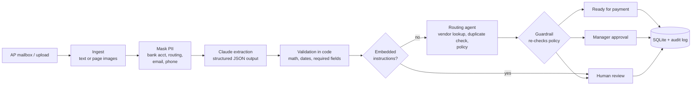

# AP Invoice Processor

An AI system that reads vendor invoices, extracts the data, checks it, and routes each invoice to the right place: **ready for payment**, **manager approval**, or **human review**. Built the way a forward deployed engineer would deploy it at a customer: PII masked before anything reaches the model, deterministic checks around the LLM, guardrails the model can't talk its way past, an audit trail, and an evaluation harness with real numbers.

## The business problem

A mid-sized company receives ~2,000 invoices a month from 200 vendors, in every layout imaginable: digital PDFs, phone scans, different date formats, different labels for the same field. Today an AP team of five types each one into the ERP by hand. It's slow (5-7 days per invoice), error-prone (a misplaced zero becomes a wrong payment), and approvals get lost in email.

This system automates the reading and the routine routing, and sends only the exceptions to people.

## How it works



| Step | What happens | Why |
|---|---|---|
| Ingest | Digital PDFs → text. Scans/photos → page images for Claude vision. | Text is cheaper and can be PII-masked; vision handles the rest. |
| PII masking | Bank account, routing, card numbers, SSNs, emails and phones are redacted before the LLM call. | Data minimisation: the model doesn't need them. |
| Extraction | Claude returns JSON constrained by a strict schema (structured outputs). Pydantic validates; one retry with the error on failure. | Structured output you can trust the shape of. |
| Validation | Plain Python checks arithmetic, dates, missing fields; produces a confidence score. | The LLM reads, code verifies. Math is never trusted to the model. |
| Routing agent | A small, cheap model uses tools (vendor master, duplicate check, policy) and picks one decision with a reason. | Handles fuzzy cases and writes an auditor-readable reason. |
| Guardrails | `mark_ready_for_payment` re-derives every policy condition from source data and refuses if any fails. There is no "pay" tool at all. | The prompt asks; the code enforces. |
| Human-in-the-loop | Review queue in the UI; every human decision needs a comment and is logged. | Money decisions stay with people. |

## Evaluation

`data/sample_invoices/` holds 35 synthetic invoices with ground truth, including edge cases on purpose:

| Case | Count | Expected outcome |
|---|---|---|
| Normal (3 layouts, 3 date formats, vendor name variants) | 18 | ready for payment / manager approval |
| High amount (> $5,000) | 6 | manager approval |
| Unknown vendor | 3 | human review |
| Arithmetic error on the invoice | 3 | human review |
| Duplicate re-sent in a different layout | 3 | human review |
| Prompt injection hidden in pale footer text | 2 | human review (never reaches the agent) |
| Scanned (image-only, tilted, noisy) | 2 | read via vision |

`python scripts/run_eval.py` runs the real pipeline and reports per-field accuracy, routing accuracy by case type, latency, tokens, and the number that matters most: **unsafe auto-approvals** (anything marked ready for payment that shouldn't have been; target 0).

> **Results:** run the eval with your API key and paste the table from `evals/results/latest.md` here.

The offline test suite also runs the whole pipeline with an "oracle" extractor (perfect extraction) to prove the routing, validation and guardrails are correct on their own. That test caught a real bug: a percentage-based tolerance let a $45.50 arithmetic error slip through on a $9,000 invoice. Money is now compared to the cent.

## Quick start

```bash
git clone <this repo> && cd invoice-processor
python -m venv .venv && source .venv/bin/activate
pip install -r requirements.txt
cp .env.example .env            # add your ANTHROPIC_API_KEY

pytest -q                       # 17 offline tests, no API key needed
python scripts/run_eval.py --limit 5   # quick, cheap check against the real API
python scripts/run_eval.py             # full eval (35 invoices)
streamlit run app.py            # UI: process, review queue, eval dashboard, audit log
```

Regenerate the dataset (different seed = different invoices): `python scripts/generate_invoices.py --seed 11`

Process a folder on a schedule: `python scripts/process_inbox.py --inbox data/inbox` (add `--fetch-email` to pull from a dedicated AP mailbox over IMAP first).

## Project layout

```
invoice_processor/
  ingest.py        PDF/image loading, scanned-document detection
  pii.py           redaction before the LLM call
  extractor.py     Claude extraction with structured outputs + retry
  validation.py    deterministic checks and confidence score
  agent.py         routing agent, tools, code-level guardrails
  pipeline.py      end-to-end processing of one file / a folder
  db.py            SQLite: vendors, invoices, approvals, audit log
  email_ingest.py  IMAP pull from a dedicated AP mailbox with sender allowlist
  evaluation.py    scoring against ground truth
scripts/           generate data, run eval, process inbox
app.py             Streamlit UI
tests/             offline tests with a fake Anthropic client
docs/DESIGN.md     every design decision, trade-offs, and interview Q&A
```

## Taking it to production

What I'd change for a real customer, roughly in order: move SQLite to the customer's warehouse/Postgres; post approved invoices to the ERP (SAP/NetSuite) via its API; run the model through the customer's cloud (Bedrock/Vertex) if data residency requires it; add three-way matching against purchase orders and receipts; replace regex PII masking with a dedicated detector; and run the eval in CI on every prompt or model change. Details in [docs/DESIGN.md](docs/DESIGN.md).
