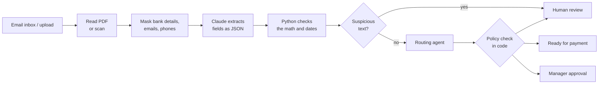

# Invoice Processor

**[▶ Try the live demo](https://invoice-process-demo.streamlit.app/)** · real Claude results on 35 sample invoices, no sign-up needed

I'm a data engineer, and most of my work has been moving messy data from one place to another and making sure it's correct when it gets there. I wanted to see what that looks like when an LLM is part of the pipeline, so I picked a problem that every finance team has: vendor invoices.

This project reads invoices (PDFs and scans), pulls out the key fields with Claude, checks the numbers in plain Python, and decides where each invoice should go: straight to payment, to a manager for approval, or to a person for review.

## The problem

Picture a company getting about 2,000 invoices a month from a couple hundred vendors. Every vendor uses a different layout. Some send clean PDFs, some send phone photos. Someone on the finance team opens each one and types the vendor, invoice number, date and amounts into the ERP by hand. It's slow, it's boring, and a single typo can mean paying the wrong amount.

I wanted the routine invoices to go through automatically and only the weird ones to reach a person.

## How it works



1. **Read the file.** Digital PDFs give me text directly. If a PDF has almost no text, it's a scan, so I send the page images to Claude instead.
2. **Mask sensitive data.** Before anything goes to the API, I strip out bank account numbers, routing numbers, emails and phone numbers. The model doesn't need them to do its job.
3. **Extract.** Claude returns the fields as JSON that has to match a schema I defined. I validate it with Pydantic and retry once if something is off.
4. **Check in code.** I don't trust the model with arithmetic. Python checks that line items add up, that subtotal plus tax equals the total, that dates make sense, and that required fields are there.
5. **Route.** A small agent looks up the vendor, checks for duplicates, reads the approval policy, and picks one of three outcomes with a short reason.
6. **Guardrail.** Even if the agent says "approve", the code re-checks every rule before an invoice is marked ready for payment. There's no tool that actually pays anyone.

Anything that needs a person shows up in a review queue in the Streamlit app. Approving or rejecting needs a comment, and everything gets written to an audit log.

## Things I designed for

- **Messy layouts.** The test set has three different invoice designs, three date formats, and vendor names that don't exactly match the vendor list ("Acme Office Supply, Inc." vs "Acme Office Supply").
- **Scanned invoices.** Two are rotated, blurry, image-only PDFs.
- **Duplicates.** The same invoice sent again in a different layout, so a file hash won't catch it. I match on vendor plus invoice number instead.
- **Bad math.** Invoices where the printed total doesn't match the line items.
- **Prompt injection.** Two invoices have pale text in the footer telling "the AI system" to approve them. Those never reach the agent; they go straight to a person.

## Results

I evaluate on 35 synthetic invoices where I know the right answer for every field. The number I care about most is **unsafe auto-approvals**: invoices marked ready for payment that shouldn't have been. That needs to be zero.

| Metric | Result |
|---|---|
| Invoices with every field correct | 35 / 35 (100%) |
| Correct routing | 35 / 35 (100%) |
| Unsafe auto-approvals | 0 |
| Avg extraction time per invoice | 2.2–2.4 s |

I got the same result on two separate full runs. That includes the hard cases: both scanned invoices, both prompt-injection attempts, all three duplicates and all three unknown vendors were routed correctly. Models: `claude-sonnet-5-5` for extraction, `claude-haiku-5-5` for routing.

To be honest about what this means: my test invoices are synthetic, so they're cleaner than real ones. 100% here tells me the pipeline and the checks work end to end; it doesn't mean it would be 100% on a real company's invoices. Handwritten notes, multi-page invoices, foreign currencies and really bad phone photos would all push the numbers down, and that's what I'd test next.

Full per-field breakdown: [`evals/results/latest.md`](evals/results/latest.md)

## What I learned from the evals

The first real run looked bad: only 1 of 3 normal invoices was routed to payment. When I read the reasons, the model wasn't the problem.

- On some layouts the invoice only shows "$", so Claude said it wasn't 100% sure the currency was USD. My code treated *any* uncertainty as a blocker. I split fields into critical ones (vendor, amounts, invoice number) that block approval and minor ones (due date, currency symbol) that just show a warning.
- One layout prints "Net 15" instead of a due date. Claude correctly returned nothing, but my test label had a calculated date. My label was wrong, not the model.

After those fixes, the same invoices went to 100% correct routing. Earlier, my unit tests also caught a validation bug: I was comparing money with a 0.5% tolerance, which let a $45.50 error slip through on a $9,000 invoice. Now amounts have to match to the cent.

Separately, the newest Claude model rejected the way I was originally asking for JSON (forcing a tool call). I read the migration guide and switched to structured outputs. Because all the API calls live in one module, that was a one-file change.

## Running it

```bash
pip install -r requirements.txt
pytest -q                               # offline tests, no API key needed

export ANTHROPIC_API_KEY=sk-ant-...     # or use a .env file / Codespaces secret
python scripts/run_eval.py --limit 5    # quick check
python scripts/run_eval.py              # full eval, 35 invoices
streamlit run app.py                    # the review UI
```

To generate a fresh set of test invoices: `python scripts/generate_invoices.py --seed 11`

## Project layout

```
invoice_processor/
  ingest.py         reading PDFs and scans
  pii.py            masking sensitive data
  extractor.py      Claude extraction
  validation.py     math, date and field checks
  agent.py          routing agent and the policy guardrail
  pipeline.py       runs one invoice end to end
  db.py             SQLite: vendors, invoices, approvals, audit log
  email_ingest.py   pulls attachments from a shared AP mailbox
  evaluation.py     scores results against the answer key
scripts/            data generator, eval runner, batch processor
app.py              Streamlit UI
tests/              offline tests using a fake Claude client
docs/DESIGN.md      why I made each design choice
```

## If I were deploying this for a real company

I'd start by labelling 100–200 of their actual invoices and running the same eval on those, because synthetic data is always cleaner than reality. Then: connect to their ERP for the vendor list and purchase orders, add three-way matching (invoice vs PO vs receipt), swap the regex masking for a proper PII detector, and run in shadow mode for a few weeks, where the system makes a decision but a person still does the work, before letting it route anything on its own.
